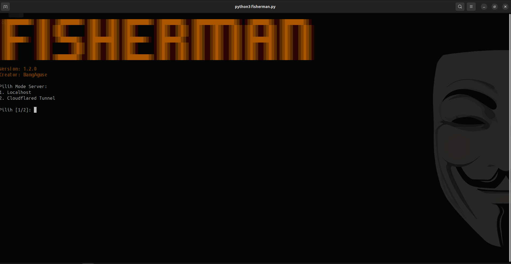

<h1 align="center">Fisherman</h1>

<strong>Dokumentasi dan panduan</strong>

<blockquote>
  <strong>Peringatan:</strong> Proyek ini memuat halaman yang meniru pemberitahuan sejumlah layanan, pengumpulan metadata browser, permintaan lokasi dan kamera, pencatatan kiriman, serta komponen untuk membuat tautan tunnel. Jalankan hanya dalam lingkungan uji yang Anda miliki atau secara eksplisit diizinkan. Jangan gunakan terhadap orang sungguhan atau untuk menyamar sebagai layanan nyata.
</blockquote>

<h2>Gambaran Umum</h2>

Fisherman adalah proyek Python yang menjalankan web server untuk menyajikan konten dari folder <code>server/</code>. Proyek ini juga memiliki pencatatan aktivitas, halaman/template demonstrasi, pembuat pesan email, serta integrasi tunnel opsional. Karena beberapa konten menyerupai komunikasi merek sungguhan dan fitur browser dapat mengirim data, proyek ini <strong>bukan</strong> alat untuk digunakan terhadap publik.

<h2>Tangkapan Layar</h2>

<h2>Alur Kerja Secara Umum</h2>
<ol>
  <li>Aplikasi CLI meminta konfirmasi untuk melanjutkan, lalu menawarkan pilihan mode server.</li>
  <li>Server menyajikan halaman dari folder <code>server/</code>. Pada mode tertentu, komponen tunnel dapat membuat alamat yang dapat dijangkau dari luar komputer.</li>
  <li>Skrip halaman mengumpulkan metadata teknis browser dan mencoba memperoleh informasi lokasi izin diberikan. Skrip juga dapat meminta izin kamera dan mengirim hasil tangkapan apabila izin diberikan.</li>
  <li>Server mencatat permintaan dan payload yang diterimanya; berkas unggahan disimpan di direktori <code>uploads/</code>.</li>
  <li>Komponen email menyediakan template pesan yang meniru pemberitahuan beberapa layanan dan dapat menyisipkan alamat halaman.</li>
</ol>

Uraian ini ditujukan untuk membantu peninjauan dan pemahaman risiko, bukan sebagai petunjuk untuk menghubungi target, menyamar sebagai layanan, atau memublikasikan server.

<h2>Data dan Risiko Privasi</h2>
<ul>
  <li>Metadata yang dikirim dapat mencakup user-agent, bahasa, platform, ukuran layar, zona waktu, referer, dan informasi perangkat lain yang tersedia di browser.</li>
  <li>Lokasi hanya tersedia jika browser mendukungnya dan pengguna memberikan izin, tetapi permintaan izin dapat mengekspos data sensitif.</li>
  <li>Akses kamera memerlukan izin browser. Jangan meminta atau merekam kamera orang lain tanpa izin.</li>
  <li>Payload dan unggahan dapat tersimpan di log atau disk. Perlakukan semuanya sebagai data sensitif; jangan mengumpulkan data akun, kata sandi, pembayaran, foto, atau data pribadi.</li>
  <li>Tunnel publik dapat membuat layanan dapat diakses pihak luar. Jangan mengaktifkannya untuk eksperimen dengan pengguna nyata atau tanpa persetujuan dan otorisasi tertulis.</li>
</ul>

<h2>Batas Penggunaan yang Aman</h2>
<ul>
  <li>Gunakan hanya untuk tinjauan kode atau demonstrasi tertutup dengan peserta yang telah diberi tahu dan menyetujui pengujian.</li>
  <li>Gunakan data sintetis dan akun uji; jangan meniru merek atau mengirim pesan yang dapat dianggap berasal dari layanan nyata.</li>
  <li>Batasi eksperimen ke lingkungan terisolasi yang Anda kendalikan. Hindari akses publik dan jangan mengirim tautan kepada pihak yang tidak ikut serta secara sadar.</li>
  <li>Hentikan pengujian jika ada data pribadi yang terkumpul tanpa sengaja, lalu amankan dan hapus data tersebut sesuai kebijakan yang berlaku.</li>
  <li>Untuk simulasi kesadaran keamanan, gunakan platform simulasi yang disetujui organisasi dan telah menyediakan kontrol persetujuan serta privasi.</li>
</ul>

<h2>Penafian</h2>

Perangkat lunak disediakan apa adanya, tanpa jaminan. Developer tidak bertanggung jawab atas penyalahgunaan, kerugian, atau konsekuensi yang timbul dari penggunaan proyek ini. Pengguna bertanggung jawab untuk memperoleh izin, menjaga privasi, mematuhi hukum, kebijakan organisasi, dan ketentuan layanan yang berlaku. Penafian ini tidak memberikan izin atau kekebalan hukum untuk melakukan tindakan yang dilarang.

<h2>Komponen Proyek</h2>
<ul>
  <li><code>fisherman.py</code>: CLI, server HTTP, dan pencatatan.</li>
  <li><code>server/</code>: halaman dan skrip browser yang disajikan oleh server.</li>
  <li><code>email_sender.py</code>: template pesan dan helper email.</li>
  <li><code>cloudflared_tunnel.py</code>: integrasi tunnel opsional.</li>
</ul>

<small>Dokumentasi ini menjelaskan perilaku yang tampak pada kode proyek. Tinjau kode dan dependensi sebelum menjalankannya.</small>

